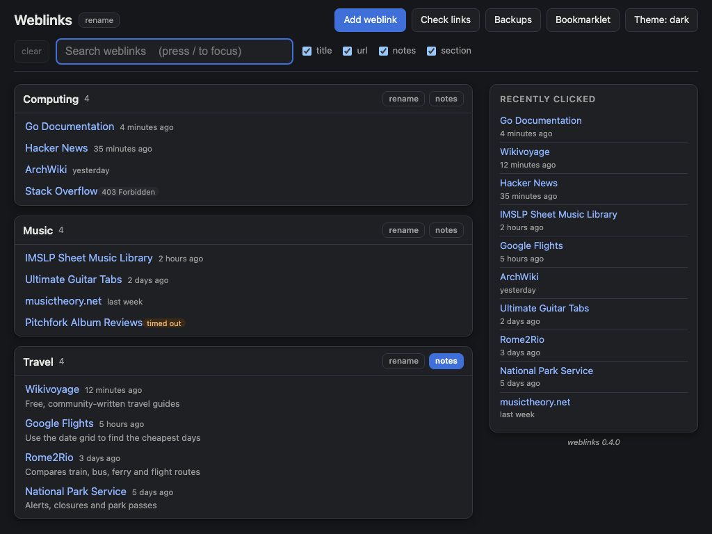
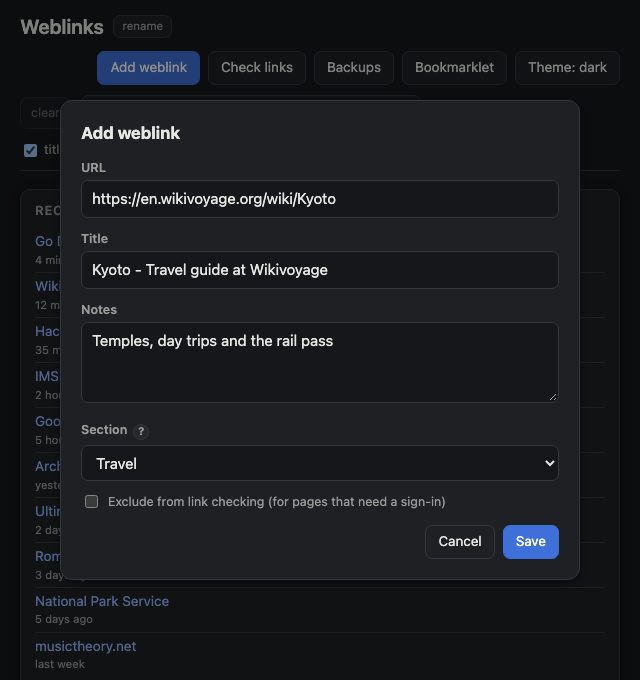

# weblinks

A personal weblinks page served by a single Go binary with no third-party
dependencies. Weblinks live in a JSON file that the server reads, writes
atomically and reloads when it changes on disk. The page is a vanilla HTML,
CSS and JavaScript client embedded in the binary, so there is nothing to
build beyond `go build`. Classification help uses a separate, editable
Markdown prompt; a generic example is included as `classification.md`.

## Screenshots

The main page in dark mode, with the Travel section's notes shown and the
recently clicked panel on the right:



The add dialog as the [bookmarklet](docs/usage.md#bookmarklet) opens it, with
the URL and title of the current page filled in:



## Features

- Search as you type across titles, URLs, notes and section names, with
  keyboard navigation. ([usage](docs/usage.md))
- Collapsible sections, with the links in each ordered by most recent click.
  ([usage](docs/usage.md))
- A bookmarklet that adds the current page, or opens the existing entry if it
  is already saved. ([bookmarklet](docs/usage.md#bookmarklet))
- An editable LLM prompt that suggests which section a new link belongs in.
  ([choosing a section](docs/usage.md#choosing-a-section))
- A dead-link checker that separates broken links from pages behind a sign-in.
  ([link checking](docs/usage.md#link-checking))
- A plain JSON store that you can edit by hand, even while the server runs.
  ([storage](docs/storage.md))
- Rolling backups with restore from the page.
  ([backups](docs/storage.md#backups))
- Duplicate detection on normalized URLs.
  ([duplicates](docs/storage.md#duplicate-detection))
- `file://` links opened with the operating system's handler.
  ([usage](docs/usage.md))
- An optional macOS LaunchAgent that starts the server at login.
  ([launchd](docs/install.md#starting-at-login-macos))

## Quick start

Requires Go 1.27 or later.

```
make build
./weblinks
```

A browser opens at <http://127.0.0.1:5309>.

| Flag | Default | Purpose |
| --- | --- | --- |
| `-addr` | `127.0.0.1:5309` | Listen address. |
| `-file` | `weblinks.json` | Path to the weblinks store. |
| `-classification-file` | `classification.md` | External classification prompt, re-read on every request. |
| `-no-open` | `false` | Do not launch a browser at startup. |
| `-check-concurrency` | `8` | Simultaneous requests used by the dead-link checker. |
| `-check-timeout` | `10s` | Per-request timeout for the dead-link checker. |
| `-allow-host` | none | Extra host names, comma separated, that may reach the server. |
| `-version` | `false` | Print the version and exit. |

See [Installing and running](docs/install.md) for the other `make` targets,
running the binary outside this repository, and starting the server at login
on macOS.

## How to import

There is no native way to import browser bookmarks into weblinks. Every
browser has its own export format and folder conventions, and keeping code
for three or more of them working would cost more than it saves. Instead, ask
an AI to do the import into `weblinks.json` for you, using the prompt in
[docs/import-prompt.md](docs/import-prompt.md).

1. Export your bookmarks to HTML:
   - Chrome, Edge, Brave, Vivaldi: open the bookmark manager, then the
     three-dot menu, then **Export bookmarks**.
   - Firefox: **Bookmarks**, then **Manage bookmarks**, then **Import and
     Backup**, then **Export Bookmarks to HTML**.
   - Safari: **File**, then **Export**, then **Bookmarks**. On newer
     versions, use **File**, then **Export Browsing Data to File**, and give
     the AI the bookmarks HTML file from the resulting archive.
2. Stop the weblinks server.
3. Give an AI agent that can read and write files (Claude Code, for example)
   the prompt, the exported file and the path to `weblinks.json`. It proposes
   how your folders map to sections and waits for you to confirm before it
   writes anything.

Existing weblinks are kept, duplicates are skipped, and the store is copied to
`weblinks--pre-import.json` first so you can undo the import.

## Security

The server has no authentication. Keep `-addr` on a loopback address unless
you intend to publish your weblinks to the network. See
[Request guard](docs/security.md) for what protects the API from other pages
open in your browser.

## Documentation

- [Installing and running](docs/install.md), including
  [starting at login (macOS)](docs/install.md#starting-at-login-macos)
- [Using the page](docs/usage.md), including the
  [bookmarklet](docs/usage.md#bookmarklet),
  [choosing a section](docs/usage.md#choosing-a-section) and
  [link checking](docs/usage.md#link-checking)
- [Storage, backups and duplicate detection](docs/storage.md)
- [Request guard](docs/security.md)
- [Importing bookmarks (AI prompt)](docs/import-prompt.md)

## Development

```
main.go                     flags, wiring, startup and shutdown
classification.md           external generic prompt with a {{sections}} placeholder
internal/launch/            hands a URL to the OS: the browser, or a file link
internal/bookmarks/         data model, the JSON store, backups and URL keys
internal/linkcheck/         concurrent dead-link checker
internal/web/               HTTP handlers, the origin guard and the embedded UI
internal/web/assets/        templates plus app.css and app.js
launchd/                    LaunchAgent template and its installer
screenshots/                README images and the Playwright script that makes them
docs/                       documentation linked from this README
```

```
make test          # go test ./...
make race          # under the race detector
make check         # gofmt check, vet and tests together
make screenshots   # regenerate the README screenshots from demo data
```

`make screenshots` needs [uv](https://docs.astral.sh/uv/), which installs
Playwright on first use. It serves its own demo data, so your `weblinks.json`
is never touched.

## Disclaimer

This program was vibe-coded with Claude Fable and Claude Opus at high effort.
The code has tests, but it was not written line by line by a person, and no one
has audited it. Use it at your own risk. The author is not responsible for:

- weblinks that fail to save, or that are silently lost;
- a `weblinks.json` that is corrupted, truncated or overwritten, including by a
  restore from the wrong backup or by editing the file while the server runs;
- backups that are missing, incomplete or pruned before you needed them;
- link-check results that call a working link dead or a dead link alive;
- anything that happens when you open a `file://` link, which the server hands
  to the operating system and which launches an application or script if the
  link points at one;
- a hostile web page getting past the request guard and reading or changing
  your weblinks, because the server has no authentication.

Keep your own copy of `weblinks.json` if its contents matter to you.

## License

weblinks is released under the [MIT License](LICENSE). As that license states,
the software is provided "as is", without warranty of any kind, express or
implied, and in no event shall the author be liable for any claim, damages or
other liability arising from its use.
